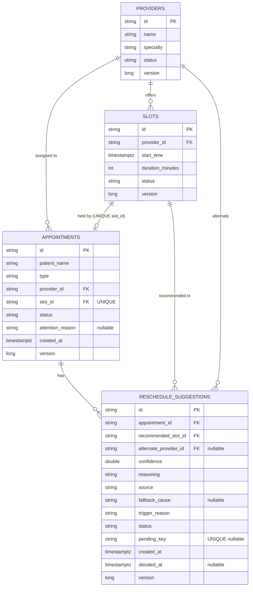
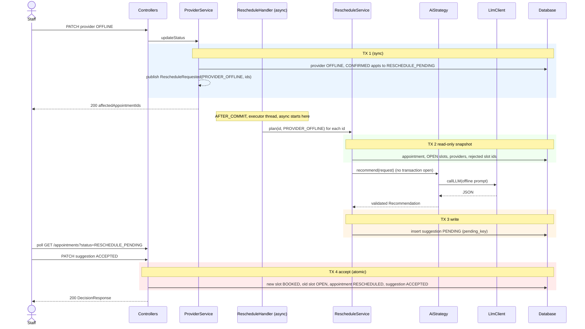
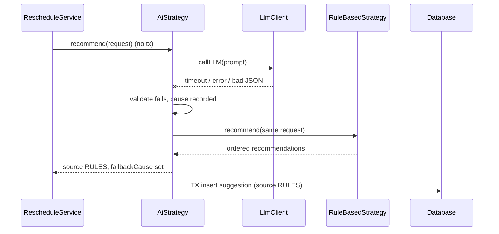
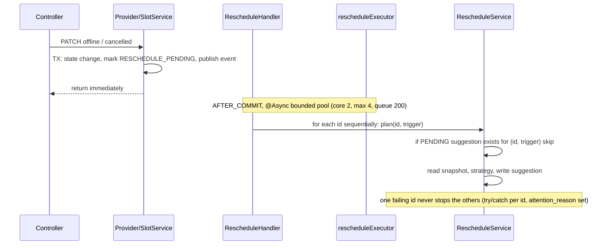
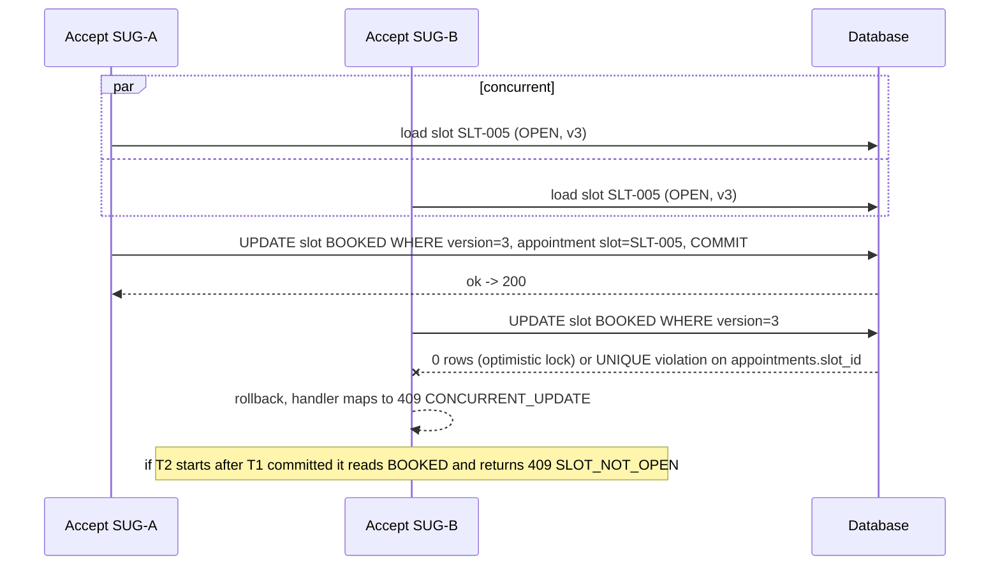

# DESIGN: SlotMind AI Re-Scheduling Engine

Owner of: architecture, ERD, API contracts, flows, error model. Requirements and invariants (I1..I10) live in [PROBLEM.md](PROBLEM.md). AI prompts, validation and guards live in `AI_LAYER.md`. Decisions and trade-offs live in `ADR.md`.
Example data below uses a fixed "now" of `2026-10-13T09:00:00Z` and the Addendum A seed (offsets in minutes: SLT-001 +60 = 10:00Z, SLT-002 +120 = 11:00Z, SLT-003 +90 = 10:30Z, SLT-004 +180 = 12:00Z, SLT-005 +150 = 11:30Z, SLT-006 +240 = 13:00Z).

---
## 1. Architecture

### 1.1 Package map (base `com.slotmind`)
```
api         controllers, request/response DTO records, GlobalExceptionHandler      -> service
service     business rules, @Transactional boundaries, event publishing/handling   -> domain, scheduling
scheduling  SchedulingStrategy seam, RuleBasedStrategy, AiStrategy, registry       -> ai (AiStrategy only), plain records (no JPA)
ai          LlmClient seam, LLMGateway (Claude API), PromptBuilder, ResponseValidator  -> nothing in the project
domain      JPA entities with state methods, enums, Spring Data repositories       -> nothing
config      AsyncConfig (bounded executor), Clock bean, properties, SeedData, startup check
```
Allowed dependency direction: `api -> service -> {domain, scheduling}`; `scheduling -> ai`. `domain`, `ai` and `scheduling` never import `service` or `api`. `scheduling` and `ai` never import JPA types, so strategies are pure functions of an immutable request and can be unit-tested with no database.

### 1.2 Main classes (one line each)
| Class | Responsibility |
|---|---|
| `AppointmentService` | book, list, get, on-demand suggest (orchestrates snapshot -> strategy -> persist) |
| `ProviderService` / `SlotService` | status changes; on OFFLINE / CANCELLED mark affected appointments `RESCHEDULE_PENDING` and publish `RescheduleRequested` in the same transaction |
| `RescheduleHandler` | `@TransactionalEventListener(AFTER_COMMIT)` + `@Async("rescheduleExecutor")`; one handler for both triggers (AGT-1) |
| `RescheduleService` | `plan(appointmentId, trigger)`: short read tx -> strategy (no tx) -> short write tx. Used by the handler and by `POST /suggest` |
| `SuggestionService` | accept / reject; the single atomic accept transaction (I2) |
| `Appointment`, `Slot`, `Provider`, `RescheduleSuggestion` | entities; status changes only through methods that enforce legal transitions (I8) |
| `SchedulingStrategy` | seam 1: `List<Recommendation> recommend(SchedulingRequest)` |
| `RuleBasedStrategy` | deterministic tiers (see 1.4); also the fallback |
| `AiStrategy` | builds one of two prompts, calls `LlmClient`, validates, falls back to `RuleBasedStrategy` |
| `StrategyRegistry` | collects all `SchedulingStrategy` beans by `name()`; `active()` reads `slotmind.scheduling.strategy` |
| `LlmClient` | seam 2: `String callLLM(String prompt)` plus overload with system text; `LLMGateway` is the real Claude implementation, tests use a fake |
| `GlobalExceptionHandler` | the one `@RestControllerAdvice`, maps everything to the standard error body |

### 1.3 The two seams
1. **`SchedulingStrategy`**: input is `SchedulingRequest(appointment, trigger, candidateSlots, providers, excludedSlotIds, now)`, output is an ordered `List<Recommendation(slotId, providerId, alternateProviderId, confidence, reasoning, source, fallbackCause)>`. The service persists element 0. Adding `RoomConstraintStrategy` = one class annotated `@Component` with a `name()`; no other file changes.
2. **`LlmClient`**: the brief's `LLMGateway.callLLM(prompt)` signature is kept; `AiStrategy` depends on the interface only.

### 1.4 Rule-based ranking (used by `RuleBasedStrategy` and as fallback)
Candidates: slot `OPEN`, start after `now`, provider not `OFFLINE`, slot not the appointment's own, slot not in `excludedSlotIds` (slots previously rejected for this appointment). Order by tier, then `startTime`, then `slotId`:
1. same provider as the appointment (only possible on SLOT_CANCELLED or manual) confidence 0.90
2. other provider with the **same specialty** confidence 0.70
3. `URGENT` only: any other non-offline provider confidence 0.50 (decision D3)

### 1.5 Conventions
Constructor injection only; no Lombok; DTOs are Java records, entities never leave the service layer (services return DTOs; the `from(entity)` factories are called inside the transaction). `Instant` everywhere, serialised ISO-8601 UTC. Enums stored as `STRING`. Ids are strings (`PRV-001`, new ones `APT-` / `SUG-` + 8 hex chars). A `Clock` bean is injected wherever "now" is needed. Property names: existing `llm.api.key=${LLM_API_KEY:}`; everything else under `slotmind.*`.

### 1.6 Stack
Java 21 + Spring Boot 3.5 (given); JPA/Hibernate (given, `@Version` and constraints); H2 for tests and default run, Postgres via Docker for the demo; Jackson (strict parsing of LLM JSON); official `anthropic-java` SDK with a hard timeout and `maxRetries(0)` for the Claude API (no Spring AI, out of scope; see AI_LAYER.md section 6); JUnit 5 + MockMvc + AssertJ; React 18 + Vite with plain `fetch` and polling every 4 s.

---
## 2. ERD



### 2.1 `providers`
| Column | Type | Null | Key / index | Why |
|---|---|---|---|---|
| id | varchar(20) | no | PK | brief uses string ids |
| name | varchar(100) | no | | display |
| specialty | varchar(20) | no | | `GENERAL/SPECIALIST/PEDIATRIC`; drives matching rule |
| status | varchar(20) | no | idx(status) | `AVAILABLE/BUSY/OFFLINE`; filtered when building candidates |
| version | bigint | no | | `@Version`; concurrent status flips -> 409 |

### 2.2 `slots`
| Column | Type | Null | Key / index | Why |
|---|---|---|---|---|
| id | varchar(20) | no | PK | |
| provider_id | varchar(20) | no | FK providers; idx(provider_id, start_time) | "nearest slot of provider" query |
| start_time | timestamptz | no | idx(status, start_time) | nearest-open-slot query |
| duration_minutes | int | no | CHECK > 0 | |
| status | varchar(20) | no | | `OPEN/BOOKED/CANCELLED` |
| version | bigint | no | | **core of I1**: two concurrent bookings of one slot cannot both commit |

### 2.3 `appointments`
| Column | Type | Null | Key / index | Why |
|---|---|---|---|---|
| id | varchar(20) | no | PK | |
| patient_name | varchar(100) | no | | |
| type | varchar(20) | no | | `ROUTINE/URGENT/FOLLOW_UP` |
| provider_id | varchar(20) | no | FK; idx(provider_id, status) | loop finds a provider's CONFIRMED appointments |
| slot_id | varchar(20) | no | FK, **UNIQUE** | an appointment points at its *current* slot only, so uniqueness = no two appointments on one slot (I1 backstop) |
| status | varchar(30) | no | idx(status) | UI filter `?status=` |
| attention_reason | varchar(30) | yes | | `NO_CANDIDATE_SLOT` / `ENGINE_ERROR` when re-plan produced nothing (A4); cleared when a suggestion is created |
| created_at | timestamptz | no | | |
| version | bigint | no | | `@Version` |

### 2.4 `reschedule_suggestions`
| Column | Type | Null | Key / index | Why |
|---|---|---|---|---|
| id | varchar(20) | no | PK | |
| appointment_id | varchar(20) | no | FK; idx(appointment_id, status) | queue lookup, rejected-slot exclusion |
| recommended_slot_id | varchar(20) | no | FK; idx(recommended_slot_id) | stale detection, joins |
| alternate_provider_id | varchar(20) | yes | FK | set iff slot's provider differs from the appointment's provider |
| confidence | double | no | CHECK 0..1 | |
| reasoning | varchar(500) | no | | patient-friendly text |
| source | varchar(10) | no | | `LLM` / `RULES` |
| fallback_cause | varchar(20) | yes | | why rules ran instead of the LLM (`TIMEOUT, GATEWAY_ERROR, PARSE_ERROR, INVALID_SLOT, INVALID_PROVIDER, SLOT_NOT_OPEN, MODEL_DECLINED, NO_API_KEY, REFUSED`) |
| trigger_reason | varchar(20) | no | | `INITIAL/PROVIDER_OFFLINE/SLOT_CANCELLED` |
| status | varchar(10) | no | | `PENDING/ACCEPTED/REJECTED` |
| pending_key | varchar(80) | yes | **UNIQUE** | `appointmentId:triggerReason` while PENDING, NULL otherwise. Portable "one PENDING per appointment+trigger" (partial unique indexes are not available on H2). Duplicate insert -> constraint violation -> skipped |
| created_at / decided_at | timestamptz | no / yes | | audit |
| version | bigint | no | | `@Version`; double accept of one suggestion |

Schema is created by Hibernate (`ddl-auto`, no Flyway) from entity annotations (`@Table(uniqueConstraints, indexes)`). Seed (Addendum A) is loaded by `SeedData` (an `ApplicationRunner`, skipped when providers exist, disabled in tests with `slotmind.seed.enabled=false`) using `Clock`-relative minutes, because `NOW() + 60` is not portable SQL.

### 2.5 State machines (enforced by entity methods)
```
Appointment : CONFIRMED -> RESCHEDULE_PENDING -> RESCHEDULED -> COMPLETED      (no other moves; rejected suggestion leaves it RESCHEDULE_PENDING)
Slot        : OPEN -> BOOKED -> OPEN (accept frees old slot) ; OPEN|BOOKED -> CANCELLED (terminal)
Suggestion  : PENDING -> ACCEPTED | REJECTED (terminal)
Provider    : any -> any (no machine in the brief); OFFLINE entry fires the loop
```

---
## 3. API contracts

Common to all endpoints: JSON (`Content-Type: application/json`), no auth, ids are strings, timestamps ISO-8601 UTC (`2026-10-13T11:30:00Z`), enums upper-case as listed. Errors use the single body in section 5; each endpoint lists only the statuses it can return. Common DTO records:

**`ProviderResponse`**: `{id: string, name: string, specialty: GENERAL|SPECIALIST|PEDIATRIC, status: AVAILABLE|BUSY|OFFLINE}`
**`SlotResponse`**: `{id: string, providerId: string, providerName: string, startTime: instant, durationMinutes: int, status: OPEN|BOOKED|CANCELLED}`
**`SuggestionResponse`**: `{id, appointmentId, recommendedSlot: SlotResponse, alternateProvider: ProviderResponse|null, confidence: number 0..1, lowConfidence: boolean (confidence < 0.5), reasoning: string, source: LLM|RULES, fallbackCause: enum|null, triggerReason: INITIAL|PROVIDER_OFFLINE|SLOT_CANCELLED, status: PENDING|ACCEPTED|REJECTED, createdAt: instant, decidedAt: instant|null}`
**`AppointmentResponse`**: `{id, patientName, type: ROUTINE|URGENT|FOLLOW_UP, status: CONFIRMED|RESCHEDULE_PENDING|RESCHEDULED|COMPLETED, provider: ProviderResponse, slot: SlotResponse, attentionReason: NO_CANDIDATE_SLOT|ENGINE_ERROR|null, pendingSuggestion: SuggestionResponse|null, createdAt: instant}`
**`PageResponse<T>`**: `{items: T[], page: int (0-based), size: int (effective, after cap), totalElements: long, totalPages: int}`

Pagination rule for every paged list: `page` default 0, `size` default 20, **max 50** (larger values are clamped to 50 and the clamped value is echoed in `size`); `page < 0` or `size < 1` -> 400. Sort is fixed and deterministic (stated per endpoint).

### 3.1 `POST /appointments` (T-1 book to provider + slot)
**REQUEST** headers: `Content-Type: application/json`. No path/query params.
| Field | Type | Required | Rules |
|---|---|---|---|
| patientName | string | yes | not blank, max 100 |
| type | enum | yes | `ROUTINE`, `URGENT`, `FOLLOW_UP` |
| providerId | string | yes | not blank; must exist |
| slotId | string | yes | not blank; must exist, belong to `providerId`, be `OPEN` and in the future |
```json
{ "patientName": "Maria Lopez", "type": "ROUTINE", "providerId": "PRV-002", "slotId": "SLT-004" }
```
**RESPONSE** `201 Created`, header `Location: /appointments/APT-7F3A91C2`, body `AppointmentResponse` (status `CONFIRMED`, `attentionReason: null`, `pendingSuggestion: null`).
```json
{ "id": "APT-7F3A91C2", "patientName": "Maria Lopez", "type": "ROUTINE", "status": "CONFIRMED",
  "provider": { "id": "PRV-002", "name": "Dr. James Okonkwo", "specialty": "SPECIALIST", "status": "AVAILABLE" },
  "slot": { "id": "SLT-004", "providerId": "PRV-002", "providerName": "Dr. James Okonkwo", "startTime": "2026-10-13T12:00:00Z", "durationMinutes": 30, "status": "BOOKED" },
  "attentionReason": null, "pendingSuggestion": null, "createdAt": "2026-10-13T09:00:00Z" }
```
**Errors**
| Status | Cause | Body |
|---|---|---|
| 400 | blank field, bad enum, slot not owned by provider, malformed JSON | `{"timestamp":"2026-10-13T09:00:00Z","status":400,"error":"Bad Request","message":"Validation failed","path":"/appointments","details":["patientName: must not be blank","type: must be one of ROUTINE, URGENT, FOLLOW_UP"]}` |
| 404 | provider or slot id unknown | `{"timestamp":"2026-10-13T09:00:00Z","status":404,"error":"Not Found","message":"Slot SLT-999 not found","path":"/appointments","details":[]}` |
| 409 | slot not OPEN, provider OFFLINE, or lost the race (optimistic lock / UNIQUE) | `{"timestamp":"2026-10-13T09:00:00Z","status":409,"error":"Conflict","message":"Slot is not available","path":"/appointments","details":["SLOT_NOT_OPEN: SLT-001 is BOOKED"]}` |

**Behaviour**: not idempotency-keyed (A6): a client retry after success hits `SLOT_NOT_OPEN` 409, which is the natural idempotency. Concurrency: two bookings of one slot -> exactly one 201, others 409 (`@Version` on slot + UNIQUE `appointments.slot_id`). UI reads: not used by the screen (tests and demo only).

### 3.2 `GET /appointments` (T-1 filterable list, T-5 queue)
**REQUEST** query params:
| Param | Type | Required | Default | Rules |
|---|---|---|---|---|
| status | enum | no | all | `CONFIRMED, RESCHEDULE_PENDING, RESCHEDULED, COMPLETED`; invalid -> 400 |
| page | int | no | 0 | >= 0 |
| size | int | no | 20 | 1..50, clamped |
Sort: `slot.startTime ASC, id ASC`.
**RESPONSE** `200`, body `PageResponse<AppointmentResponse>`. Each item embeds its single PENDING suggestion (loaded with one extra query for the page, no N+1).
```json
{ "items": [
  { "id": "APT-001", "patientName": "John Martinez", "type": "ROUTINE", "status": "RESCHEDULE_PENDING",
    "provider": { "id": "PRV-001", "name": "Dr. Sarah Chen", "specialty": "GENERAL", "status": "OFFLINE" },
    "slot": { "id": "SLT-001", "providerId": "PRV-001", "providerName": "Dr. Sarah Chen", "startTime": "2026-10-13T10:00:00Z", "durationMinutes": 30, "status": "BOOKED" },
    "attentionReason": null,
    "pendingSuggestion": {
      "id": "SUG-11AB22CD", "appointmentId": "APT-001",
      "recommendedSlot": { "id": "SLT-005", "providerId": "PRV-004", "providerName": "Dr. Rahul Verma", "startTime": "2026-10-13T11:30:00Z", "durationMinutes": 30, "status": "OPEN" },
      "alternateProvider": { "id": "PRV-004", "name": "Dr. Rahul Verma", "specialty": "GENERAL", "status": "AVAILABLE" },
      "confidence": 0.88, "lowConfidence": false,
      "reasoning": "Dr. Chen is out today. Dr. Rahul Verma, also a general practitioner, can see you at 11:30 AM, about 90 minutes after your original time.",
      "source": "LLM", "fallbackCause": null, "triggerReason": "PROVIDER_OFFLINE", "status": "PENDING",
      "createdAt": "2026-10-13T09:00:04Z", "decidedAt": null },
    "createdAt": "2026-10-13T08:00:00Z" } ],
  "page": 0, "size": 20, "totalElements": 1, "totalPages": 1 }
```
Empty list: `{"items":[],"page":0,"size":20,"totalElements":0,"totalPages":0}`.
**Errors**: `400` bad `status` / `page` / `size`: `{"timestamp":"2026-10-13T09:00:00Z","status":400,"error":"Bad Request","message":"Invalid request parameter","path":"/appointments","details":["status: must be one of CONFIRMED, RESCHEDULE_PENDING, RESCHEDULED, COMPLETED"]}`.
**UI reads**: `items[].{id, patientName, type, status, attentionReason, provider.name, slot.startTime}` and `pendingSuggestion.{id, recommendedSlot.providerName, recommendedSlot.startTime, alternateProvider, confidence, lowConfidence, reasoning, source, triggerReason}`. The UI treats `status = RESCHEDULE_PENDING` and `pendingSuggestion = null` and `attentionReason = null` as "planning in progress", and `attentionReason != null` as "needs manual handling".

### 3.3 `GET /appointments/{id}`
**REQUEST** path `id` (string, required). **RESPONSE** `200` `AppointmentResponse` (same example item as 3.2). Needed as the target of `Location` and for tests.
**Errors**: `404` `{"timestamp":"2026-10-13T09:00:00Z","status":404,"error":"Not Found","message":"Appointment APT-999 not found","path":"/appointments/APT-999","details":[]}`.

### 3.4 `GET /providers` (T-5 provider list)
**REQUEST** none. Not paginated: the roster is bounded (clinic staff), stated exception to the pagination rule. Sort `name ASC`.
**RESPONSE** `200` body `ProviderResponse[]`:
```json
[ { "id": "PRV-001", "name": "Dr. Sarah Chen", "specialty": "GENERAL", "status": "OFFLINE" },
  { "id": "PRV-002", "name": "Dr. James Okonkwo", "specialty": "SPECIALIST", "status": "AVAILABLE" } ]
```
No error statuses beyond 500. **UI reads**: all four fields.

### 3.5 `PATCH /providers/{id}/status` (T-1, T-4 trigger)
**REQUEST** path `id`. Body:
| Field | Type | Required | Rules |
|---|---|---|---|
| status | enum | yes | `AVAILABLE`, `BUSY`, `OFFLINE` |
```json
{ "status": "OFFLINE" }
```
**RESPONSE** `200` (returns immediately; planning continues asynchronously), body `ProviderStatusResponse` `{provider: ProviderResponse, affectedAppointmentIds: string[] (appointments moved to RESCHEDULE_PENDING by this call), rescheduleQueued: boolean}`:
```json
{ "provider": { "id": "PRV-001", "name": "Dr. Sarah Chen", "specialty": "GENERAL", "status": "OFFLINE" },
  "affectedAppointmentIds": ["APT-001", "APT-002"], "rescheduleQueued": true }
```
Same status as current -> `200` with `affectedAppointmentIds: []`, `rescheduleQueued: false` (no event).
**Errors**: `400` bad enum / missing status (body as 3.1 with `path` `/providers/PRV-001/status`); `404` `{"timestamp":"2026-10-13T09:00:00Z","status":404,"error":"Not Found","message":"Provider PRV-999 not found","path":"/providers/PRV-999/status","details":[]}`; `409` concurrent flip: `{"timestamp":"2026-10-13T09:00:00Z","status":409,"error":"Conflict","message":"Provider was modified concurrently, retry","path":"/providers/PRV-001/status","details":["CONCURRENT_UPDATE"]}`.
**Behaviour**: in one transaction: provider -> OFFLINE, every `CONFIRMED` appointment of that provider -> `RESCHEDULE_PENDING`, publish one `RescheduleRequested(PROVIDER_OFFLINE, ids)`. AFTER_COMMIT the async handler plans each id. **UI reads**: `provider.status`, then the UI refetches the queue by polling.

### 3.6 `GET /slots` (T-5 slot list)
**REQUEST** query: `status` (enum `OPEN|BOOKED|CANCELLED`, optional), `providerId` (string, optional), `page` (0), `size` (20, max 50). Sort `startTime ASC, id ASC`.
**RESPONSE** `200` `PageResponse<SlotResponse>`:
```json
{ "items": [ { "id": "SLT-005", "providerId": "PRV-004", "providerName": "Dr. Rahul Verma", "startTime": "2026-10-13T11:30:00Z", "durationMinutes": 30, "status": "OPEN" } ],
  "page": 0, "size": 20, "totalElements": 1, "totalPages": 1 }
```
Empty: `{"items":[],"page":0,"size":20,"totalElements":0,"totalPages":0}`. **Errors**: `400` invalid enum / page / size (body shape as 3.2, `path` `/slots`). **UI reads**: all fields.

### 3.7 `PATCH /slots/{id}/status` (T-1, T-4 trigger)
**REQUEST** path `id`. Body: `status` enum, required, **only `CANCELLED` is accepted** (booking and release happen only through appointments and accept; any other value -> 409 `ILLEGAL_TRANSITION`).
```json
{ "status": "CANCELLED" }
```
**RESPONSE** `200` `SlotStatusResponse` `{slot: SlotResponse, affectedAppointmentIds: string[], rescheduleQueued: boolean}`:
```json
{ "slot": { "id": "SLT-002", "providerId": "PRV-001", "providerName": "Dr. Sarah Chen", "startTime": "2026-10-13T11:00:00Z", "durationMinutes": 30, "status": "CANCELLED" },
  "affectedAppointmentIds": ["APT-002"], "rescheduleQueued": true }
```
Cancelling an already `CANCELLED` slot -> `200`, `[]`, `false`. Cancelling an `OPEN` slot (nobody on it) -> `200`, `[]`, `false`.
**Errors**: `400` missing/invalid status; `404` slot unknown (shape as 3.5); `409` `{"timestamp":"2026-10-13T09:00:00Z","status":409,"error":"Conflict","message":"Illegal slot transition","path":"/slots/SLT-002/status","details":["ILLEGAL_TRANSITION: slot status can only be set to CANCELLED"]}` or `CONCURRENT_UPDATE`.
**Behaviour**: transaction: slot -> CANCELLED; if a `CONFIRMED` appointment holds it -> `RESCHEDULE_PENDING`; publish `RescheduleRequested(SLOT_CANCELLED, [id])`. An appointment already `RESCHEDULE_PENDING` is left alone (A5).

### 3.8 `POST /appointments/{id}/suggest` (T-1/T-2/T-3 on-demand)
**REQUEST** path `id`. Optional query `strategy` (string, `ai` or `rule`, default = configured `slotmind.scheduling.strategy`; demonstrates runtime switching through the same registry the async path uses). No body.
Allowed when appointment is `CONFIRMED` or `RESCHEDULE_PENDING`. Runs **synchronously** (strategy call is outside any transaction, hard LLM timeout 8 s, so worst case the call returns the rule-based result after ~8 s).
**RESPONSE** `201 Created`, header `Location: /appointments/APT-001`, body `SuggestionResponse` (`triggerReason: INITIAL`, `status: PENDING`):
```json
{ "id": "SUG-5D9E01AA", "appointmentId": "APT-002",
  "recommendedSlot": { "id": "SLT-005", "providerId": "PRV-004", "providerName": "Dr. Rahul Verma", "startTime": "2026-10-13T11:30:00Z", "durationMinutes": 30, "status": "OPEN" },
  "alternateProvider": { "id": "PRV-004", "name": "Dr. Rahul Verma", "specialty": "GENERAL", "status": "AVAILABLE" },
  "confidence": 0.7, "lowConfidence": false,
  "reasoning": "Dr. Rahul Verma (general practice) has the nearest opening at 11:30 AM.",
  "source": "RULES", "fallbackCause": "TIMEOUT", "triggerReason": "INITIAL", "status": "PENDING",
  "createdAt": "2026-10-13T09:01:10Z", "decidedAt": null }
```
**Errors**
| Status | Cause | Body |
|---|---|---|
| 400 | unknown `strategy` value | `{"timestamp":"2026-10-13T09:01:00Z","status":400,"error":"Bad Request","message":"Unknown strategy","path":"/appointments/APT-002/suggest","details":["strategy: must be one of ai, rule"]}` |
| 404 | appointment unknown | shape as 3.3 |
| 409 | appointment is `RESCHEDULED`/`COMPLETED`, or a `PENDING` suggestion already exists | `{"timestamp":"2026-10-13T09:01:00Z","status":409,"error":"Conflict","message":"A pending suggestion already exists","path":"/appointments/APT-002/suggest","details":["PENDING_SUGGESTION_EXISTS: SUG-5D9E01AA"]}` |
| 422 | no candidate slot at all (e.g. a ROUTINE pediatric appointment, as no open pediatric slot exists) | `{"timestamp":"2026-10-13T09:01:00Z","status":422,"error":"Unprocessable Entity","message":"No suitable slot is available","path":"/appointments/APT-005/suggest","details":["NO_CANDIDATE_SLOT"]}` |

LLM failure is **not** an error: the rule-based result comes back as `201` with `source: RULES` and `fallbackCause` set. 503 is never returned for AI failure. **Behaviour**: persist step moves a `CONFIRMED` appointment to `RESCHEDULE_PENDING` and sets `pending_key`; the UNIQUE key makes a concurrent double-click return 409. On 422 a `CONFIRMED` appointment stays `CONFIRMED`. The planner refuses (409 `PENDING_SUGGESTION_EXISTS`) when the appointment has a PENDING suggestion of *any* trigger, which is stricter than the per-trigger `pending_key`; the UNIQUE key remains the race backstop. **UI reads**: the whole `SuggestionResponse` (button "Request suggestion").

### 3.9 `PATCH /suggestions/{id}` (T-1 accept or reject)
**REQUEST** path `id`. Body:
| Field | Type | Required | Rules |
|---|---|---|---|
| status | enum | yes | `ACCEPTED` or `REJECTED` (`PENDING` is invalid -> 400) |
```json
{ "status": "ACCEPTED" }
```
**RESPONSE** `200`, body `DecisionResponse` `{suggestion: SuggestionResponse (decided), appointment: AppointmentResponse (fresh state)}`:
```json
{ "suggestion": { "id": "SUG-11AB22CD", "appointmentId": "APT-001", "recommendedSlot": { "id": "SLT-005", "providerId": "PRV-004", "providerName": "Dr. Rahul Verma", "startTime": "2026-10-13T11:30:00Z", "durationMinutes": 30, "status": "BOOKED" },
    "alternateProvider": { "id": "PRV-004", "name": "Dr. Rahul Verma", "specialty": "GENERAL", "status": "AVAILABLE" },
    "confidence": 0.88, "lowConfidence": false, "reasoning": "Dr. Chen is out today. Dr. Rahul Verma, also a general practitioner, can see you at 11:30 AM.",
    "source": "LLM", "fallbackCause": null, "triggerReason": "PROVIDER_OFFLINE", "status": "ACCEPTED", "createdAt": "2026-10-13T09:00:04Z", "decidedAt": "2026-10-13T09:03:30Z" },
  "appointment": { "id": "APT-001", "patientName": "John Martinez", "type": "ROUTINE", "status": "RESCHEDULED",
    "provider": { "id": "PRV-004", "name": "Dr. Rahul Verma", "specialty": "GENERAL", "status": "AVAILABLE" },
    "slot": { "id": "SLT-005", "providerId": "PRV-004", "providerName": "Dr. Rahul Verma", "startTime": "2026-10-13T11:30:00Z", "durationMinutes": 30, "status": "BOOKED" },
    "attentionReason": null, "pendingSuggestion": null, "createdAt": "2026-10-13T08:00:00Z" } }
```
Reject returns the same envelope with `suggestion.status = REJECTED` and `appointment.status = RESCHEDULE_PENDING`, `pendingSuggestion: null`.
**Errors**
| Status | Cause | Body |
|---|---|---|
| 400 | missing/invalid status | shape as 3.1, `details:["status: must be ACCEPTED or REJECTED"]` |
| 404 | suggestion unknown | shape as 3.3 |
| 409 | `SUGGESTION_NOT_PENDING`, `APPOINTMENT_NOT_PENDING`, `SLOT_NOT_OPEN` (taken/cancelled since), `PROVIDER_OFFLINE` (target provider went offline), `CONCURRENT_UPDATE` (lost the race) | `{"timestamp":"2026-10-13T09:03:31Z","status":409,"error":"Conflict","message":"Suggested slot is no longer available","path":"/suggestions/SUG-5D9E01AA","details":["SLOT_NOT_OPEN: SLT-005 is BOOKED"]}` |

**Behaviour (I2, I3, AGT-3)**: accept is one `@Transactional` method: re-validate (suggestion PENDING, appointment RESCHEDULE_PENDING, new slot OPEN, target provider not OFFLINE) -> `newSlot.book()`, `oldSlot.release()` (stays CANCELLED if it was), `appointment.reschedule(newSlot)`, `suggestion.accept()` -> commit. `@Version` conflicts and the UNIQUE `appointments.slot_id` both map to 409, so of N concurrent accepts for one slot exactly one returns 200. Reject never touches slots. No LLM call. **UI reads**: `suggestion.status`, `appointment.status`; a 409 shows `details[0]` to staff and the UI refetches the queue.

### 3.10 `POST /appointments/{id}/suggest/stream` (T-3 bonus +5, build last, first thing cut)
**REQUEST** same as 3.8 (no body, optional `strategy`), header `Accept: text/event-stream`. **RESPONSE** `200`, `Content-Type: text/event-stream`. Events (each `data:` is JSON):
| Event | Data | When |
|---|---|---|
| `status` | `{"state":"PLANNING"}` | stream opened |
| `reasoning` | `{"text":"..."}` | one or more chunks of the reasoning text |
| `result` | `SuggestionResponse` | suggestion persisted; stream then closes |
| `error` | standard error body (section 5) | 404 / 409 / 422 conditions after the stream opened |
It reuses `RescheduleService` (same dedupe, same fallback). Errors detectable before streaming (404, 409) return a normal JSON error.

### 3.11 `GET /actuator/health`
Provided by the starter. `200 {"status":"UP"}`. Used by `S1` smoke checks.

---
## 4. Flows

### 4.1 Happy path (book -> provider offline -> suggestion -> accept)
Trigger: `POST /appointments`, later `PATCH /providers/PRV-001/status {OFFLINE}`, then `PATCH /suggestions/{id} {ACCEPTED}`.

Persisted: TX1 provider + appointments; TX3 suggestion; TX4 slots + appointment + suggestion. Events: one `RescheduleRequested` per trigger call. If TX3 hits the UNIQUE `pending_key` the id is skipped (duplicate PENDING).

### 4.2 LLM failure -> fallback
Trigger: same as 4.1 but the call times out (8 s), the gateway throws, JSON is invalid, or validation fails (slot not OPEN / unknown, provider unknown or OFFLINE, `alternateProviderId` not equal to the slot's provider, confidence outside [0,1]).

No transaction is open during the LLM call. Nothing is dropped: the suggestion exists with `source=RULES`, `fallbackCause=<cause>`. If even the rules find no candidate: no suggestion, `attention_reason = NO_CANDIDATE_SLOT`, appointment stays `RESCHEDULE_PENDING`. An unexpected exception: `attention_reason = ENGINE_ERROR`. Fallbacks are counted by cause in a log line.

### 4.3 Provider offline and re-plan (many appointments) / slot cancelled (one)
Trigger: `PATCH /providers/{id}/status OFFLINE` (N appointments) or `PATCH /slots/{id}/status CANCELLED` (0..1 appointment). Both publish the same `RescheduleRequested(trigger, ids)`; the handler is the same and only the prompt differs by `trigger` (AGT-1).

No batch de-confliction: two appointments may get the same slot (seed demo: APT-001 and APT-002 both get SLT-005). That is deliberate (I3); the second accept returns 409. If the executor queue rejects the task, the error is logged and the appointments stay `RESCHEDULE_PENDING` with no suggestion, recoverable through `POST /suggest`.

### 4.4 Double accept / concurrent update
Trigger: two staff accept suggestions that both recommend SLT-005 (or accept the same suggestion twice) at the same moment.

Transaction boundary: the whole accept method; nothing is partially applied. Three layers (ADR): service re-validation, `@Version` on slot/suggestion, UNIQUE `appointments.slot_id`. Same suggestion accepted twice: `@Version` on the suggestion or the `PENDING` check gives `SUGGESTION_NOT_PENDING`/`CONCURRENT_UPDATE`. Test: ExecutorService + CountDownLatch, N threads, expected exactly one 200 and the rest 409.

---
## 5. Error model (defined once)
Every non-2xx response, from the single `GlobalExceptionHandler`, uses:
```json
{ "timestamp": "2026-10-13T09:00:00Z", "status": 409, "error": "Conflict", "message": "Suggested slot is no longer available", "path": "/suggestions/SUG-5D9E01AA", "details": ["SLOT_NOT_OPEN: SLT-005 is BOOKED"] }
```
`timestamp` ISO-8601 UTC; `status` the numeric code; `error` the HTTP reason phrase; `message` one human sentence; `path` the request path; `details` array of strings, empty when there is nothing to add. For 400 each detail is `field: message`; for 409/422 the first detail starts with a stable code (`SLOT_NOT_OPEN`, `PROVIDER_OFFLINE`, `ILLEGAL_TRANSITION`, `CONCURRENT_UPDATE`, `SUGGESTION_NOT_PENDING`, `APPOINTMENT_NOT_PENDING`, `PENDING_SUGGESTION_EXISTS`, `NO_CANDIDATE_SLOT`) so clients and tests can assert on it.

| Status | When | Exceptions mapped |
|---|---|---|
| 400 | Bean Validation failure, malformed JSON, bad enum/param type, `page`/`size` out of range | `MethodArgumentNotValidException`, `HttpMessageNotReadableException`, `MethodArgumentTypeMismatchException`, `ConstraintViolationException` |
| 404 | id does not exist | `NotFoundException` |
| 409 | illegal state transition, slot/provider state conflict, duplicate pending, lost race | `ConflictException(code, message)`, `ObjectOptimisticLockingFailureException`, `DataIntegrityViolationException` |
| 422 | request is valid but no candidate slot exists | `UnprocessableException` |
| 500 | anything else; body has a generic message and **no stack trace or SQL** (logged server-side) | `Exception` |

AI failures never surface as an HTTP error (fallback instead); there is no 503 in this API. No 401/403 (no auth in scope).
